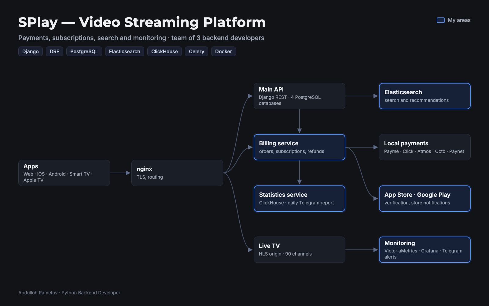
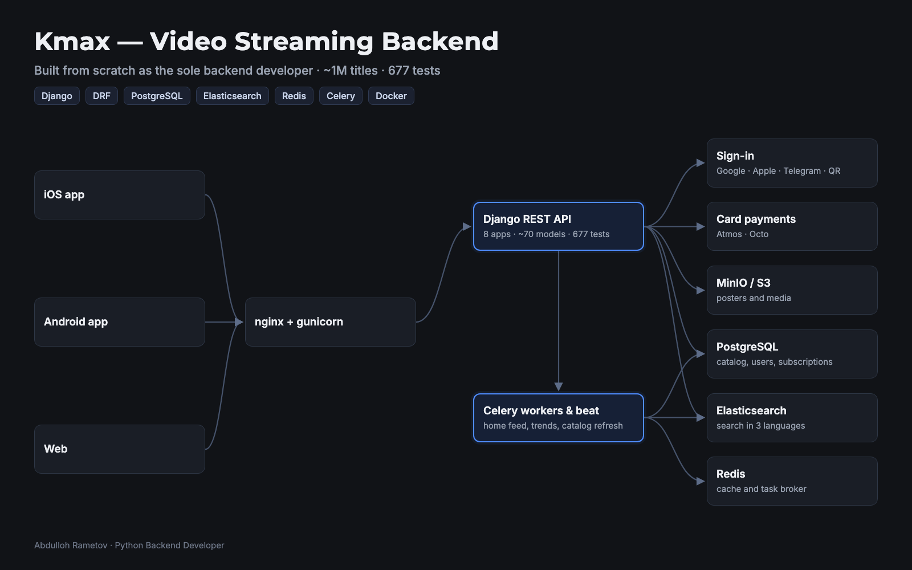
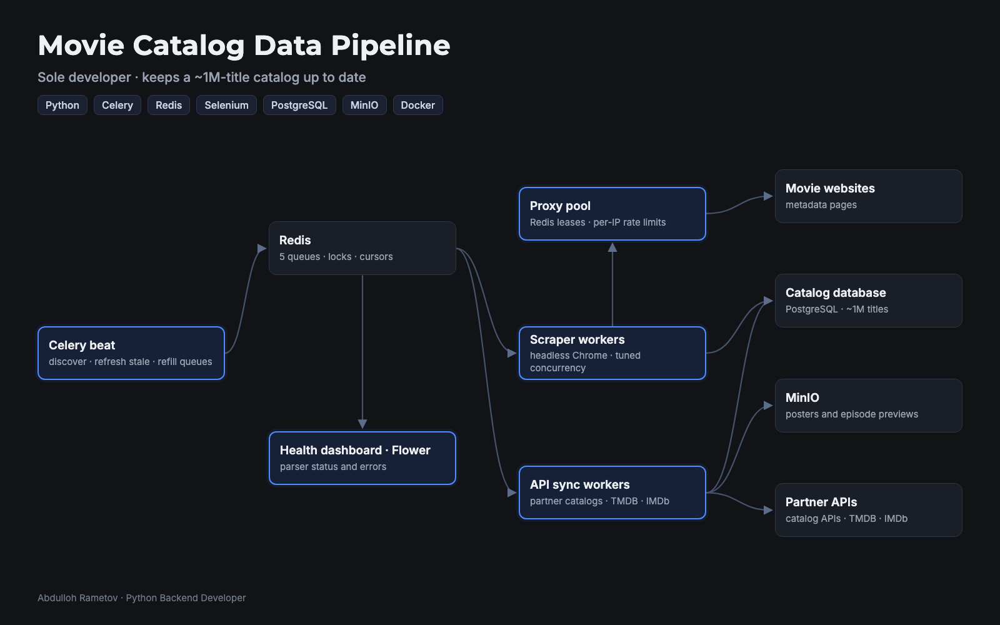
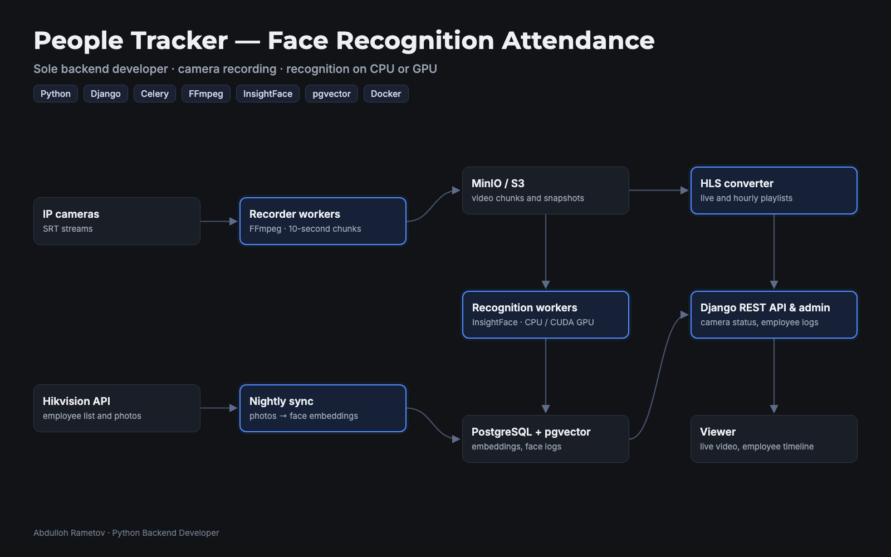
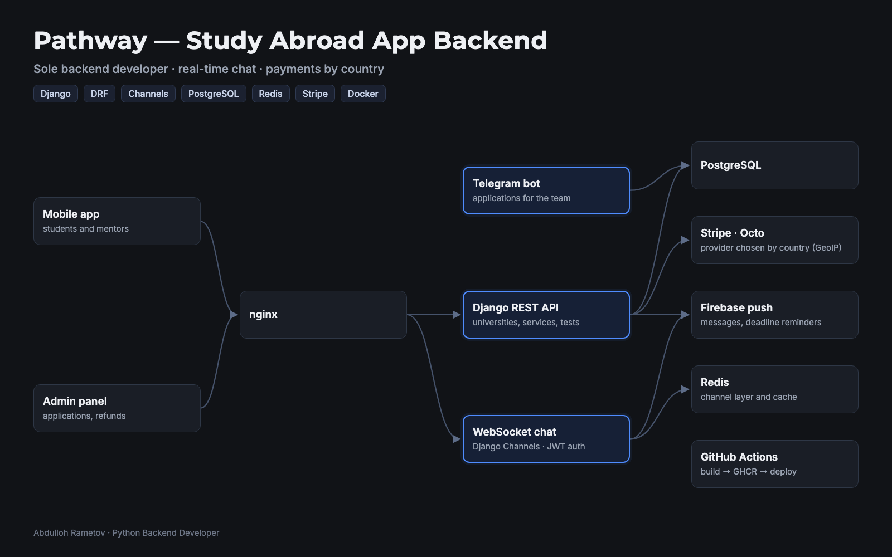

# Abdulloh Rametov

**Python Backend Developer** · Tashkent, Uzbekistan · 4 years with Django and DRF

I build production backends for streaming platforms, payments and real-time systems, from spec to deploy, with tests and monitoring.

[LinkedIn](https://www.linkedin.com/in/rametov) · [Telegram](https://t.me/rametov_a)

## Selected work

Most of my code lives in private company repositories, so here are architecture diagrams of systems I built or own. Highlighted blocks are my areas.

### SPlay — video streaming platform (web, iOS, Android, Smart TV)

- App Store and Google Play subscriptions with protection against double charges
- Billing with local payments: Payme, Click, Atmos, Octo
- Elasticsearch search: removed 2M duplicates from the index, improved relevance and recommendations
- Security audit of authorization and payments; monitoring of 90 live TV channels with Telegram alerts

### Kmax — streaming backend built from scratch

- Sole backend developer: 8 Django apps, ~70 models, 677 tests
- Sign-in with Google, Apple, Telegram and QR; profiles and session limits
- Personalized home feed and trends; search in 3 languages
- Heavy pages sped up from 5 s to 0.06 s; card subscriptions via Atmos and Octo

### Movie catalog data pipeline

Keeps a ~1M-title catalog up to date: Celery beat schedules, Redis queues and locks, a proxy pool with per-IP rate limits, headless Chrome scrapers, TMDB and IMDb sync, media in MinIO.

### People Tracker — face recognition attendance

Records IP cameras with FFmpeg, recognizes employees with InsightFace on CPU or GPU, stores embeddings in PostgreSQL with pgvector and shows a timeline of appearances with video playback.

### Pathway — study abroad app backend

Real-time chat between students and mentors on Django Channels, Firebase push and deadline reminders, Stripe or Octo chosen by the user's country, deploys with GitHub Actions.

### Also

- **ICCU** — 7 services, including the backend for 300 iPads at an international forum (350 events, 3 cities, 4 languages) and a real-time museum tour on iPad
- **TLS school app** — journal, grades, Payme and Click payments; 257 tests
- **AutoAssist** (own project) — roadside assistance in Tashkent: nearest specialist matching, live tracking, specialist wallet; 173 tests

## Stack

- **Backend:** Python, Django, DRF, FastAPI, Celery, Django Channels (WebSockets)
- **Data:** PostgreSQL, Redis, Elasticsearch, ClickHouse, MinIO / S3
- **Payments:** Payme, Click, Atmos, Octo, Stripe, App Store and Google Play subscriptions
- **Infrastructure:** Docker, nginx, Linux, GitHub Actions, Grafana, VictoriaMetrics
- **Video and CV:** HLS, FFmpeg, InsightFace, OpenCV
